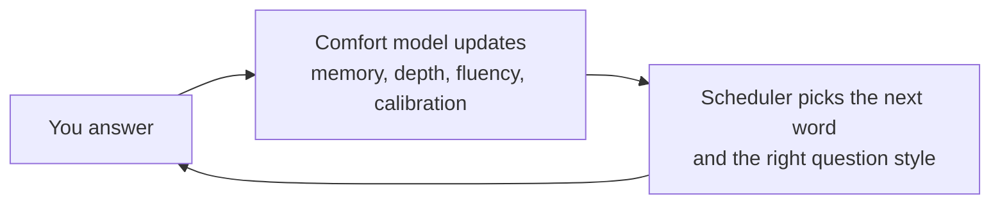

# GRE Prep

**An adaptive GRE study app that learns how well you know every word, and a study coach that helps you decide what to do next.**

---

Flashcard apps track whether you got a word right. GRE Prep also tracks *how* you know it: whether you can only recognize it or can use it, how fast you answer, and whether your confidence matches your results. It schedules every review around that, mixes in Verbal and Quant practice at your level, and gives you a coach that can see your progress.

## Features

### Adaptive vocabulary
- **1,057 GRE words in 37 study sets.** The first 32 follow GregMat's well-known groups. Every word has a definition, a nuance note, common phrases, example sentences, synonyms, antonyms, and look-alikes to watch out for.
- **Five question styles** that get harder as you improve: flashcard, pick the definition, complete the sentence, pick the two synonyms, and write your own sentence (graded by AI).
- **Smart scheduling.** Reviews come back right before you'd forget, using the FSRS-5 memory model. Words you keep mixing up come back as each other's wrong answers.
- **A comfort score for every word**, from *Learning* through *Shaky* and *Comfortable* to *Mastered*.

### Placement check
A 20-question adaptive test estimates your vocabulary level, so words you already know skip the basics and you don't spend days on them.

### Verbal and Quant practice
Original GRE-style questions in all six formats: Text Completion, Sentence Equivalence, Reading Comprehension, Quantitative Comparison, multiple choice, and numeric entry. Questions are matched to a rating for each type that rises and falls with your answers, and every question has a hint and a full explanation.

### Study coach
A chat bubble on every page, powered by Claude. Ask *"What is my current vocabulary progress?"*, *"Which section should I work on?"*, or *"Help me set a target."* It knows your progress, and when it suggests a new pace or test date, you save it with one click. On a question it coaches without giving the answer away until you've answered.

### Make words stick
- **Your sentence.** Write your own sentence with a word. It appears whenever the word's meaning is revealed.
- **Mnemonics.** Get a memorable sound-alike or image for any word, on request.
- **Pronunciation.** Every word has a stress-marked respelling (luh-**kah**-nik) and a speaker button to hear it.

### Dashboard
Comfort tiers, depth of knowledge, a 7-day review forecast, your streak, accuracy, and the words that need the most work.

## How it learns you

Every answer updates four signals for that word:

| Signal | What it measures |
|---|---|
| **Memory** | How likely you are to recall the word today, and how long until you'd forget it |
| **Depth** | Can you recognize it → recall it → tell it apart from look-alikes → use it? |
| **Fluency** | How fast you answer, compared with your own usual speed |
| **Calibration** | Whether your *Sure / Unsure / Guess* tap matches how you actually did |

## Built with

| | |
|---|---|
| **Frontend** | React, TypeScript, Vite, Tailwind CSS, shadcn/ui |
| **Backend** | FastAPI, SQLAlchemy, Alembic |
| **Database** | PostgreSQL on Supabase |
| **Sign-in** | Clerk (invite-only) |
| **AI** | Claude, via the Anthropic API |
| **Hosting** | Vercel, or Docker Compose |

## Running it

See **[how_to_run.md](how_to_run.md)** to start it with Docker in two commands or run it locally. Configuration, deployment and how it works are in the **[development guide](DEVELOPMENT.md)**.

## Content and credits

- **Questions and word entries are original**, written for this app. Study sets follow the word groupings of [GregMat](https://www.gregmat.com/)'s vocabulary list, and the 20 most-tested words come from Magoosh's public list; definitions and examples are written separately.
- **Scheduling** uses the open [FSRS](https://github.com/open-spaced-repetition) algorithm.
- *GRE® is a registered trademark of ETS. This project is not endorsed by or affiliated with ETS.*
